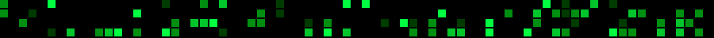

  

  
  

<h3 align="center"><code>&gt;_ stack</code></h3>

  

<h3 align="center"><code>&gt;_ projects</code></h3>

  Right now most of my evenings go into <a href="https://github.com/ileanasaintpaul/Moonbrew"><b>Moonbrew</b></a>, a cozy farm-and-café life sim made with Unity.

  

<h3 align="center"><code>&gt;_ stats</code></h3>

  
  

  <picture>
    <source media="(prefers-color-scheme: dark)" srcset="https://raw.githubusercontent.com/ileanasaintpaul/ileanasaintpaul/output/snake-dark.svg" />
    
  </picture>

